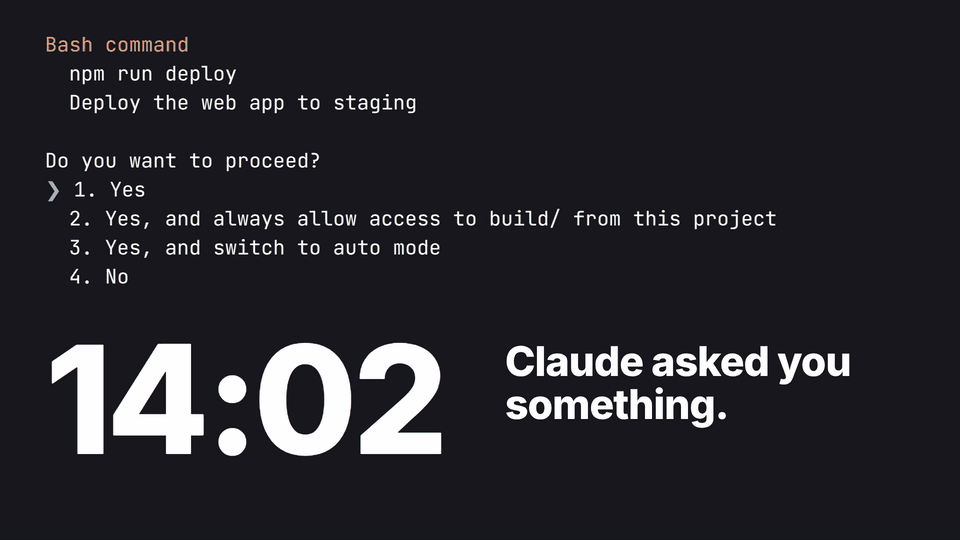
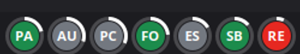

<div align="center">

<a href="https://github.com/cufelix/claude-session-dots/blob/main/assets/launch.mp4">
  
</a>

<sub>33-second launch film. Click for the full 1080p version.</sub>

# Claude Session Dots

### Stop checking every tab. Look up only when it's red.

One dot on your Cinnamon panel for every running [Claude Code](https://claude.com/claude-code) session.<br>
When Claude needs you, its dot turns red and blinks.



<sub>The real applet on a real panel, with a real permission prompt waiting in <code>RE</code>.</sub>


</div>

---

## The problem

You start six Claude Code sessions. One stops to ask for permission. The other five keep working, every tab looks the same, and you find the stuck one 45 minutes later.

## Read a dot in one glance

| | State | What it means |
|---|---|---|
|  | **Needs you** | A permission prompt, a question or a dialog is waiting, or Claude ended its turn with a question |
|  | **Working** | Claude is busy, leave it alone |
|  | **Idle** | Nothing is running, or you are in the session's shell |

Each dot also carries:

- **Letters:** the session's initials, such as `PA` for `poker-app-c3`.
- **White ring:** how full the context is, assuming a 1M window.
- **Hover:** name, state and for how long, context size, model, folder and git branch. On a red dot, the end of Claude's last message too.
- **Left click:** raises the session's terminal window.

```text
web-app
NEEDS YOU: permission prompt for 45m · 290k context · opus-5-5
~/projects/web-app (main)
```

## Install

You need Cinnamon, Python 3 and Claude Code on the same machine.

```bash
git clone https://github.com/cufelix/claude-session-dots.git
ln -s "$PWD/claude-session-dots/claude-session-dots@cufelix" ~/.local/share/cinnamon/applets/
```

Then right-click the panel, choose **Applets**, and add **Claude Session Dots**.

## How it works

```text
~/.claude/sessions/*.json ─── state ───┐
                                       ├─▶ collect.py ─ JSON ─▶ applet.js ─▶ dots
session transcript, last 4 MB ─ data ──┘    every 2 seconds
```

- It only reads local files and sends nothing over the network.
- `collect.py` uses only the Python standard library.
- Exited sessions disappear on the next poll, even if their session file is left behind.
- It respects `CLAUDE_CONFIG_DIR` if that is set in the environment Cinnamon runs in.

These files are Claude Code's internal format, not a public API, so a Claude Code update could break the applet.

## Limitations

- A question is detected by a `?` on the last line of Claude's final message. Questions followed by more lines are missed, and a rhetorical `?` shows red until you reply.
- A clicked dot raises the terminal window but can't switch to the right tab, so use the session name in the tooltip. If one terminal process owns several windows, the first one is raised. Sessions inside tmux have no window to raise.

## Development

```bash
python3 claude-session-dots@cufelix/test_collect.py
```

The launch film is in [`film/`](film/), made with [HyperFrames](https://github.com/heygen-com/hyperframes). Its session names and times are illustrative, and it has no sound. To rebuild it, run `python3 build.py`, then `npx hyperframes render` from that folder.

## License

MIT
